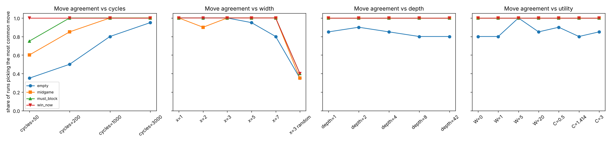
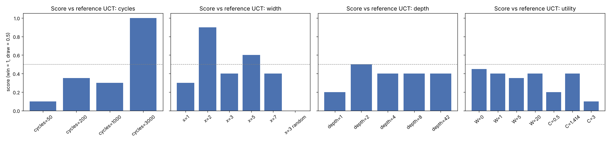
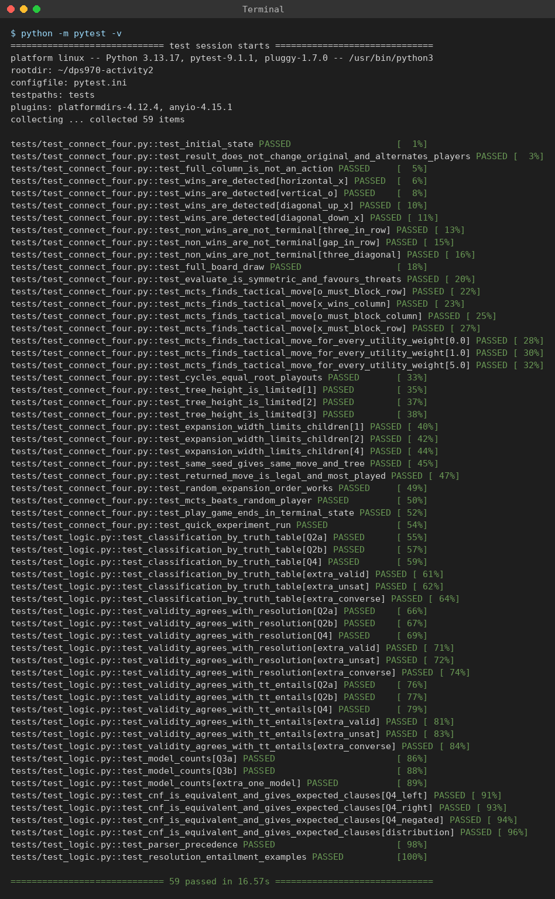
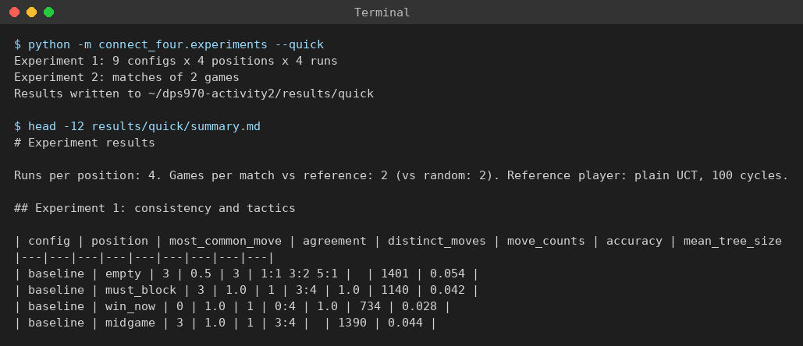
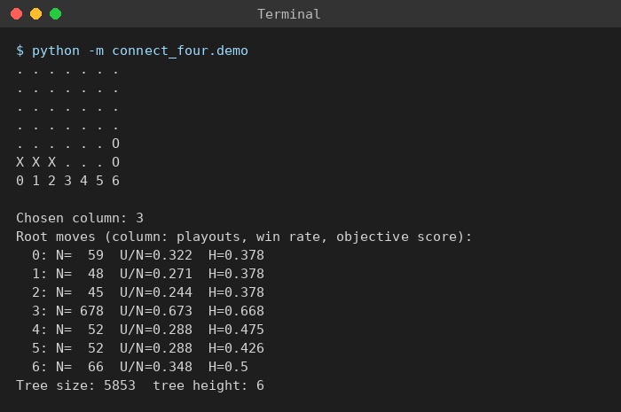

# DPS970 Activity 2: Written Answers and Report

**Student:** Ashutosh Verma
**Textbook:** Russell and Norvig, *Artificial Intelligence: A Modern Approach*, 4th edition (AIMA)

The code, tests and instructions for running them are described in [README.md](README.md).

---

## Question 1: Monte Carlo Tree Search for Connect Four

### 1.1 Design

The game is defined in `connect_four/game.py` with the six components of a
game from AIMA Section 5.1, and the move generator in `connect_four/mcts.py`
follows Figure 5.11:

```
function MONTE-CARLO-TREE-SEARCH(state) returns an action
    tree <- NODE(state)
    while IS-TIME-REMAINING() do
        leaf   <- SELECT(tree)
        child  <- EXPAND(leaf)
        result <- SIMULATE(child)
        BACK-PROPAGATE(result, child)
    return the move in ACTIONS(state) whose node has highest number of playouts
```

| Textbook | Code |
|---|---|
| S0, TO-MOVE, ACTIONS, RESULT, IS-TERMINAL, UTILITY (Section 5.1) | `ConnectFour.initial`, `to_move`, `actions`, `result`, `is_terminal`, `utility` |
| MONTE-CARLO-TREE-SEARCH (Figure 5.11) | `MCTSPlayer.monte_carlo_tree_search` |
| IS-TIME-REMAINING() | a fixed number of `cycles` (configurable) |
| SELECT | `MCTSPlayer.select` using `MCTSPlayer.utility` |
| EXPAND | `MCTSPlayer.expand` (creates x children) |
| SIMULATE | `MCTSPlayer.simulate` (random playout) |
| BACK-PROPAGATE | `MCTSPlayer.back_propagate` |
| N(n), U(n) (Section 5.4) | `Node.N`, `Node.U` |
| final choice: most playouts | `max(tree.children, key=N)` |

All settings are in `MCTSConfig`:

| Setting | Meaning | Baseline |
|---|---|---|
| `cycles` | iterations of the main loop | 1000 |
| `expansion_width` (x) | children created when a node is expanded | 7 (all moves) |
| `max_depth` | height of the tree | 42 (no limit) |
| `c` | UCB1 exploration constant C | 1.414 (√2) |
| `w_objective` (W) | weight of the objective part of the utility | 1.0 |
| `expansion_order` | which x moves get expanded: by objective score or at random | objective |

**Selection utility.** The activity asks for a utility with a playout part and
an objective part. The playout part is UCB1 from Section 5.4. The objective
part is a rule based evaluation of the position:

```
UTILITY(n) = U(n)/N(n)                                   exploitation (playouts)
           + C * sqrt( ln N(PARENT(n)) / N(n) )           exploration  (playouts)
           + W * H(n) / (N(n) + 1)                        objective    (rules)
```

- U(n) is the number of wins (a draw counts ½) for the player who made the
  move into n, and N(n) the number of playouts through n. Both are stored in
  the tree from previous cycles.
- H(n) comes from the rules of Connect Four (`ConnectFour.evaluate`): every
  line of four cells that still only holds one player's pieces is a possible
  win for that player. A line with 3 pieces scores 5, a line with 2 pieces
  scores 2, a piece in the centre column scores 3 (it belongs to the most
  lines), and the opponent's lines count against the player. A won position
  scores ±1000. The score is squashed into [0, 1] with
  0.5 + 0.5 tanh(score / 20) so it is on the same scale as the win rate.
- Dividing the objective part by N(n) + 1 means the rules guide the search
  while a node has few playouts, and the playout results take over as they
  build up. W = 0 turns the utility into plain UCB1 (plain UCT).
- An unvisited child is always selected before visited ones (its UCB1 value
  is infinite); with W > 0 the one with the best objective score goes first.

**Expansion.** When SELECT reaches a leaf, EXPAND creates x children at once.
With `expansion_order = "objective"` these are the x moves with the best
objective score for the player to move (so a winning or blocking move is
always included when one exists); with `"random"` they are x random moves. No
other moves are ever searched below that node, so x is the width of the tree at
every level. EXPAND returns one of the new children for SIMULATE.

**Fixed tree height.** A leaf at depth `max_depth` (or a terminal position) is
not expanded. SIMULATE runs from the leaf itself, so with a small height
more and more playouts are run from the same few nodes.

**Simulation.** The playout policy is uniform random: each player drops a
piece in a random non-full column until someone wins or the board is full.

**Back-propagation.** Every node on the path gets N + 1, and U + 1 if the
player who moved into that node won (U + ½ for a draw).

**Final move.** As in Figure 5.11, the root child with the most playouts.

**Repeat a configurable number of times.** `cycles` sets the number of
iterations, and `last_stats` records the playouts, win rate and objective
score of every root move, the tree size and height, and the time taken.

### 1.2 Experiments

`python -m connect_four.experiments` changes **one setting at a time** from
the baseline (1000 cycles, x = 7, no depth limit, C = 1.414, W = 1, objective
expansion order), so each difference comes from that setting alone. All raw
data is in `results/` (`consistency_runs.csv` has every single search,
`match_games.csv` every game, `summary.md` the full tables, and
`agreement.png` / `strength.png` the charts).

**Experiment 1, consistency and tactics.** Each configuration searched four
positions 20 times, with seeds 0 to 19:

| Position | Moves played (columns) | Correct move |
|---|---|---|
| `empty` | none | (centre, column 3, is the known best opening) |
| `must_block` | 0 6 1 6 2: X has three on the bottom row | 3 (O must block) |
| `win_now` | 0 1 0 1 0 2: X has three stacked in column 0 | 0 (X wins) |
| `midgame` | 3 3 2 4 4 2 5 1: no immediate threats | none |

*Agreement* is the share of the 20 runs that picked the most common move.
*Accuracy* is the share that picked the correct move.

**Experiment 2, strength.** Each configuration played 10 games against a
fixed reference player (plain UCT: W = 0, x = 7, no depth limit, 300 cycles)
and 5 games against a random player, alternating who moves first. To keep run
time reasonable every configuration used 300 cycles in the matches, except in
the cycles experiment where the cycle count is the thing being tested.

### 1.3 Results

**Number of cycles**

| Cycles | Agreement: empty | Agreement: midgame | Accuracy: must_block | Accuracy: win_now | Tree size (empty) | Score vs reference |
|---|---|---|---|---|---|---|
| 50 | 0.35 (7 different moves) | 0.60 | 0.75 | 1.00 | 351 | 0.10 |
| 200 | 0.50 (6 different moves) | 0.85 | 1.00 | 1.00 | 1,401 | 0.35 |
| 1000 | 0.80 (3 different moves) | 1.00 | 1.00 | 1.00 | 7,001 | 0.30 |
| 3000 | 0.95 (2 different moves) | 1.00 | 1.00 | 1.00 | 21,001 | **1.00** (10-0) |

**Expansion width x** (nodes expanded per level)

| x | Agreement: empty | Agreement: midgame | Tree size (empty) | Score vs reference |
|---|---|---|---|---|
| 1 | 1.00 | 1.00 | 13 | 0.30 |
| 2 | 1.00 | 0.90 | 1,493 | **0.90** |
| 3 | 1.00 | 1.00 | 2,815 | 0.40 |
| 5 | 0.95 | 1.00 | 5,001 | 0.60 |
| 7 (all) | 0.80 | 1.00 | 7,001 | 0.40 |
| 3, random order | 0.35 | 0.35 | 2,976 | **0.00** (accuracy on both tactics: 0.40) |

**Tree height**

| Max depth | Agreement: empty | Tree size (empty) | Score vs reference |
|---|---|---|---|
| 1 | 0.85 | 8 | 0.20 |
| 2 | 0.90 | 57 | 0.50 |
| 4 | 0.85 | 2,735 | 0.40 |
| 8 | 0.80 | 7,001 | 0.40 |
| 42 (none) | 0.80 | 7,001 | 0.40 |

**Utility function**

| Setting | Agreement: empty | Accuracy (both tactics) | Score vs reference |
|---|---|---|---|
| W = 0 (playout part only, plain UCT) | 0.80 | 1.00 | 0.45 |
| W = 1 (baseline) | 0.80 | 1.00 | 0.40 |
| W = 5 | **1.00** | 1.00 | 0.35 |
| W = 20 | 0.85 | 1.00 | 0.40 |
| C = 0.5 (little exploration) | 0.90 | 1.00 | 0.20 |
| C = 1.414 | 0.80 | 1.00 | 0.40 |
| C = 3 (a lot of exploration) | 0.85 | 1.00 | 0.10 |

Every configuration beat the random player in all 5 games.

### 1.4 Analysis and reflection

**Does the simulator always generate the same move?** No. With a different
random seed it often picks a different move: on the empty board the baseline
picked column 3 in 16 of 20 runs and columns 2 or 4 in the other 4; with only
50 cycles it picked 7 different moves out of 20 runs. But **with the same seed
it always gives exactly the same move and tree**: the program is fully
deterministic once the random number generator is fixed (a test checks this,
and the configurations that were identical to the baseline, such as
`depth=8`, `W=1` and `C=1.414`, produced identical numbers). So the
differences come only from the randomness, never from anything else.

**What causes the differences?**

1. **Random playouts.** The value of a move is estimated by averaging random
   games, so it is a noisy estimate. When two moves are nearly equally good
   (columns 2, 3 and 4 at the start), the noise decides which one gets the
   most playouts. This is the main source of variation.
2. **Random choices inside the tree.** EXPAND returns a random new child,
   and ties in SELECT are broken at random, so different runs grow different
   trees.
3. **Too few cycles.** The noise in an average falls roughly with 1/√N. At 50
   cycles each root move gets about 7 playouts, so the choice is almost random
   (agreement 0.35). At 3000 cycles agreement on the empty board is 0.95 and
   the generator won all 10 games against the reference. More cycles is the
   clearest way to make the move both more consistent and stronger.

**What causes the similarities?**

1. **Forced moves.** When there is an immediate win or a forced block, every
   configuration agrees (accuracy 1.00 from 200 cycles up). An immediate win
   is a terminal child whose playouts always return a win, so its win rate is
   1.0 after one visit. A missed block shows up as a child whose playouts
   almost always lose. These moves have a big gap in value over the
   alternatives, so the noise cannot hide them. Even 50 cycles found the win
   every time.
2. **The objective part of the utility.** The rule based score always
   prefers the centre column and lines of three, so it pushes every run toward
   the same moves. With W = 5 agreement on the empty board went from 0.80 to
   1.00.
3. **A narrow tree.** With small x the same few moves (the ones with the
   best objective score) are searched every time, so agreement is 1.00 for
   x = 1, 2 and 3. With x = 1 the "search" only ever has one move to pick,
   so the result is simply the rule based choice and it never varies.

**Expansion width.** x controls a trade off between width and depth. Picking
the best x moves by the objective score cuts away weak moves and lets the
cycles go deeper on the good ones: x = 2 won 9 of 10 games against the
reference. But it is a gamble on the rules: x = 1 throws search away
entirely and lost 7 of 10. The most striking result is **x = 3 with a random
order**: the tree can miss the only good move, so it found the forced block
and the immediate win only 40% of the time and lost all 10 games. Pruning only
helps when the moves kept are chosen well.

**Tree height.** With 1000 cycles the baseline tree only reaches about 6
levels, so limits of 8 or 42 change nothing (the numbers are identical). A
height of 1 means each root move is valued only by random playouts started
right after it, which is "pure Monte Carlo" with no tree, and it was the
weakest of the height settings (0.20 vs the reference). Even so it still found
the forced block and the win, because the random playouts already show a big
difference for those moves. Height matters more in quiet positions where the
best move only pays off a few moves later.

**Utility function.** C balances trying new moves against repeating good
ones. C = 0.5 explores too little (it can lock onto a move that looked good
early) and C = 3 explores too much (it spreads playouts over bad moves);
both played worse than C = √2 against the reference (0.20 and 0.10). The
objective weight W had little effect on match results at 300 cycles (all
between 0.35 and 0.45), while making the move choice more consistent. That is
what the design aims for: the objective part is divided by N(n) + 1, so it
mostly steers the early visits and the playout statistics decide in the end.

**Charts.** Move agreement for every setting, and the match score against
the reference player:





**Limitations.** Each match is only 10 games, so a score difference of 0.1
or 0.2 (one or two games) is within random noise; only the large differences
(cycles 50 vs 3000, x = 2, x = 3 random, C = 3) should be taken as real.
Times in `summary.md` were measured with two experiments running in parallel,
so they are only roughly comparable. A stronger simulator would use a
smarter playout policy (for example, always take an immediate win or block
during the playout), which would cut the noise from point 1 above.

### 1.5 Running the tests

All 59 tests pass (`python -m pytest -v`, see README.md). The same tests run
on GitHub Actions on every push (`.github/workflows/tests.yml`).



A quick experiment run (also run by GitHub Actions):



One search on the must-block position. Column 3 gets 678 of the 1000
playouts and the highest win rate (0.673) and objective score (0.668):



---

## Question 2: Propositional Logic, Satisfiability

A sentence is **valid** if it is true in every model, **unsatisfiable** if it is
true in no model, and **neither** (satisfiable but not valid) otherwise
(AIMA Section 7.5.1).

### (a) Smoke ⇒ Fire: **neither** (satisfiable, not valid)

| Smoke | Fire | Smoke ⇒ Fire |
|---|---|---|
| T | T | T |
| T | F | **F** |
| F | T | T |
| F | F | T |

It is true in three models, so it is satisfiable. It is false when Smoke is
true and Fire is false, so it is not valid.

### (b) ((Smoke ∧ Heat) ⇒ Fire) ⇔ ((Smoke ⇒ Fire) ∨ (Heat ⇒ Fire)): **valid**

Let L = (Smoke ∧ Heat) ⇒ Fire and R = (Smoke ⇒ Fire) ∨ (Heat ⇒ Fire).

| Smoke | Heat | Fire | L | Smoke ⇒ Fire | Heat ⇒ Fire | R | L ⇔ R |
|---|---|---|---|---|---|---|---|
| T | T | T | T | T | T | T | T |
| T | T | F | F | F | F | F | T |
| T | F | T | T | T | T | T | T |
| T | F | F | T | F | T | T | T |
| F | T | T | T | T | T | T | T |
| F | T | F | T | T | F | T | T |
| F | F | T | T | T | T | T | T |
| F | F | F | T | T | T | T | T |

L and R have the same value in all 8 models, so L ⇔ R is true in every model.

**Check with equivalence rules:**

- L = (Smoke ∧ Heat) ⇒ Fire
  ≡ ¬(Smoke ∧ Heat) ∨ Fire (implication elimination)
  ≡ ¬Smoke ∨ ¬Heat ∨ Fire (De Morgan)
- R = (Smoke ⇒ Fire) ∨ (Heat ⇒ Fire)
  ≡ (¬Smoke ∨ Fire) ∨ (¬Heat ∨ Fire) (implication elimination)
  ≡ ¬Smoke ∨ ¬Heat ∨ Fire ∨ Fire (associativity, commutativity)
  ≡ ¬Smoke ∨ ¬Heat ∨ Fire (idempotence)

Both sides are the same sentence, so L ⇔ R is valid.

---

## Question 3: Models

With four propositions A, B, C, D there are 2⁴ = 16 models in total.

### (a) B ∨ C: **12 models**

B ∨ C is false only when B and C are both false. That fixes B and C, and
A and D can be anything, so 2 × 2 = 4 models make it false.
16 − 4 = **12** models make it true. (Equivalently, 3 of the 4 combinations of
B and C make it true, times 4 combinations of A and D.)

### (b) (A ⇒ B) ∧ A ∧ ¬B ∧ C ∧ D: **0 models**

A conjunction needs every part true. A and ¬B force A = T and B = F. Then
A ⇒ B is T ⇒ F, which is false. So no model makes the sentence true: it is
**unsatisfiable** and has **0** models. (This is Modus Ponens: A ⇒ B and A
entail B, which contradicts ¬B.)

Both counts are checked by enumerating all 16 models in
`tests/test_logic.py::test_model_counts`.

---

## Question 4: Propositional Logic, Resolution

Sentence: [(Food ⇒ Party) ∨ (Drinks ⇒ Party)] ⇒ [(Food ∧ Drinks) ⇒ Party]

Let L be the left-hand side and R the right-hand side.

### (a) Enumeration: **valid**

| Food | Drinks | Party | Food ⇒ Party | Drinks ⇒ Party | L | Food ∧ Drinks | R | L ⇒ R |
|---|---|---|---|---|---|---|---|---|
| T | T | T | T | T | T | T | T | T |
| T | T | F | F | F | F | T | F | T |
| T | F | T | T | T | T | F | T | T |
| T | F | F | F | T | T | F | T | T |
| F | T | T | T | T | T | F | T | T |
| F | T | F | T | F | T | F | T | T |
| F | F | T | T | T | T | F | T | T |
| F | F | F | T | T | T | F | T | T |

The sentence is true in all 8 models, so it is **valid** (and therefore also
satisfiable). The only model where R is false (Food = T, Drinks = T,
Party = F) is also the only model where L is false, so the implication is never
T ⇒ F.

### (b) CNF of each side

Using the steps from AIMA Section 7.5.2: (1) eliminate ⇔, (2) eliminate ⇒,
(3) move ¬ inwards, (4) distribute ∨ over ∧.

**Left-hand side:** (Food ⇒ Party) ∨ (Drinks ⇒ Party)

1. No ⇔, so nothing changes.
2. (¬Food ∨ Party) ∨ (¬Drinks ∨ Party)
3. ¬ is already only on symbols.
4. There is no ∧, so it is already one clause. Removing the repeated literal:
   **¬Food ∨ ¬Drinks ∨ Party**

**Right-hand side:** (Food ∧ Drinks) ⇒ Party

1. No ⇔, so nothing changes.
2. ¬(Food ∧ Drinks) ∨ Party
3. De Morgan: (¬Food ∨ ¬Drinks) ∨ Party
4. No ∧ left: **¬Food ∨ ¬Drinks ∨ Party**

**How this confirms (a):** both sides become the same clause,
¬Food ∨ ¬Drinks ∨ Party. So the whole sentence has the form X ⇒ X, which is
true in every model. That is exactly what the truth table in (a) showed: L and
R are false in the same single model. (In fact L ⇔ R also holds, which is the
same identity as Question 2b with different names.)

The code prints these steps with `to_cnf_steps` and a test checks that each
CNF is equivalent to the original sentence in every model.

### (c) Proof by resolution

To show a sentence α is valid, show that ¬α is unsatisfiable: resolution
must derive the empty clause from the CNF of ¬α (PL-RESOLUTION, Figure 7.12,
with an empty KB).

¬α = ¬(L ⇒ R) ≡ ¬(¬L ∨ R) ≡ L ∧ ¬R

- L in CNF: ¬Food ∨ ¬Drinks ∨ Party
- ¬R = ¬(¬Food ∨ ¬Drinks ∨ Party) ≡ Food ∧ Drinks ∧ ¬Party (De Morgan)

Clauses:

| # | Clause | From |
|---|---|---|
| C1 | ¬Food ∨ ¬Drinks ∨ Party | L |
| C2 | Food | ¬R |
| C3 | Drinks | ¬R |
| C4 | ¬Party | ¬R |

Resolution steps:

| # | Resolve | On | Resolvent |
|---|---|---|---|
| C5 | C1, C2 | Food | ¬Drinks ∨ Party |
| C6 | C5, C3 | Drinks | Party |
| C7 | C6, C4 | Party | **empty clause** |

The empty clause means ¬α is unsatisfiable, so α is **valid**, confirming (a).

`pl_resolution` in `logic/propositional.py` finds the same refutation, and the
tests check that resolution, TT-ENTAILS and the truth table all give the same
answer for Questions 2 and 4.
